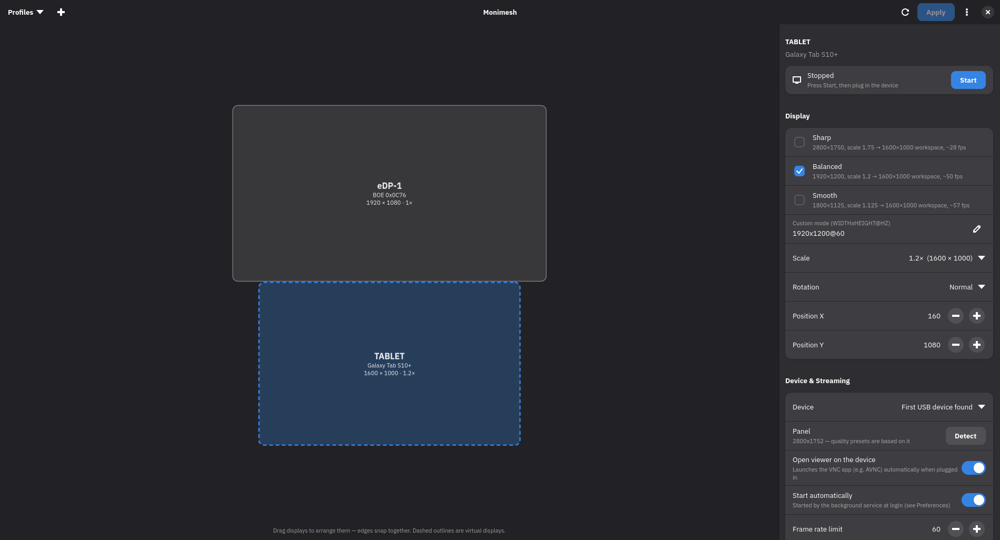

# Monimesh

**Arrange your displays on Wayland and use an Android tablet or phone as a wired second screen.**



Monimesh is a small display manager for Wayland. Drag your monitors into place, set resolution,
scale and rotation, and save the result as a named profile. Plug an Android device in with a USB
cable and it becomes another monitor. The image travels over the cable instead of Wi-Fi, so it
stays fast and responsive.

> **Wayland only.** Monimesh currently works on **Hyprland** and supports both the Lua config
> (Hyprland 0.56+) and the classic `hyprland.conf`. It does not run on X11 desktops such as XFCE.

## Features

### Display layout
- **Drag and drop.** Displays snap edge to edge and centre to centre. Guide lines appear while you
  drag.
- **Mistake warnings.** Overlapping displays and displays the cursor cannot reach are highlighted
  in red.
- **Only valid scales.** The scale list contains only values Hyprland accepts for the chosen
  resolution, so you never end up with a blurry fallback.
- **Safe apply.** After every change you have 15 seconds to confirm it. If you don't, the previous
  settings come back. A wrong setting can never leave you stuck on a black screen.
- **Survives reloads.** *Save Layout to Hyprland Config* writes `monimesh.lua` (or `.conf`) next to
  your config. With your permission it also adds the one line that loads it.

### Android device as a second screen
- **Plug and play.** The display appears when the device is plugged in and disappears when it is
  unplugged, so windows are never left on a screen you cannot see.
- **Opens the viewer for you.** When the device connects, Monimesh launches the VNC app on it, so
  you don't have to tap anything.
- **Presets from the real panel.** Monimesh reads the device's resolution and offers *Sharp*,
  *Balanced* and *Smooth* presets. Each shows its estimated frame rate and all keep the same
  workspace size.
- **Workspaces follow the device.** Pick workspaces (e.g. `6-10`) that move to the device whenever
  it connects.
- **Runs in the background.** Streaming continues after you close the window.
- **Private.** The stream only listens on `127.0.0.1` and goes through the USB cable, so nothing is
  exposed on your network.

### Profiles
- **Named layouts.** Save layouts such as *Desk*, *Laptop only* or *Presentation* and switch between
  them from the header bar.
- **Automatic switching.** Mark a profile *automatic* and it is applied as soon as exactly that set
  of monitors is connected.
- **Includes virtual displays.** A profile also records which virtual displays should be streaming.

## Requirements

- A Wayland session running **Hyprland**
- Python 3.10 or newer, with GTK 4, libadwaita 1.6+ and PyGObject
- For Android devices: **wayvnc** and **adb**

Install the dependencies with your package manager:

| Distribution | Command |
|---|---|
| Arch Linux / CachyOS / EndeavourOS | `sudo pacman -S python-gobject gtk4 libadwaita wayvnc android-tools python-pipx` |
| Fedora | `sudo dnf install python3-gobject gtk4 libadwaita wayvnc android-tools pipx` |
| Debian 13 / Ubuntu 24.10+ | `sudo apt install python3-gi gir1.2-gtk-4.0 gir1.2-adw-1 wayvnc adb pipx` |

On the Android device you need **USB debugging** and a VNC viewer.
[AVNC](https://github.com/gujjwal00/avnc) is free, open source and works well. It is available on
Google Play and F-Droid.

## Installation

### Option 1: install with pipx (recommended)

```sh
pipx install --system-site-packages git+https://github.com/0anes0/monimesh
```

`--system-site-packages` is required. It lets Monimesh use the GTK and libadwaita bindings
installed by your distribution.

To add Monimesh to your application launcher:

```sh
curl -fLo ~/.local/share/applications/io.github.monimesh.Monimesh.desktop \
  https://raw.githubusercontent.com/0anes0/monimesh/main/data/io.github.monimesh.Monimesh.desktop
```

Update with `pipx upgrade monimesh`. Remove with `pipx uninstall monimesh`.

### Option 2: run from source

```sh
git clone https://github.com/0anes0/monimesh
cd monimesh
python3 -m monimesh
```

Nothing is installed. Run `git pull` to update.

## Using an Android device as a second screen

1. **Enable USB debugging on the device.** Open Settings → About → Software information and tap
   **Build number** 7 times. Then go to Settings → Developer options and turn on **USB debugging**.
2. **Connect the cable.** On the "Allow USB debugging?" prompt, tick *Always allow* and confirm.
3. **Add the display.** In Monimesh press **+**, choose the device and press **Add**.
4. **Place it.** Drag the dashed rectangle to where the device sits relative to your screen and
   press **Apply**.

From now on the display comes up every time you plug the device in while it is started. Turn on
*Start automatically* and the background service (*Preferences → Run in the background*) to have
it ready after every login.

### Which preset should I use?

The frame rate depends on how many pixels are streamed, not on the cable. Every frame is
compressed on the CPU. Measured on a Galaxy Tab S10+ (2800×1752 panel) with a full-screen 60 fps
video:

| Preset | Mode | Scale | Workspace | fps |
|---|---|---|---|---|
| Sharp | 2800×1750 | 1.75 | 1600×1000 | ~28 |
| **Balanced** | 1920×1200 | 1.2 | 1600×1000 | **~50** |
| Smooth | 1800×1125 | 1.125 | 1600×1000 | ~57 |

*Balanced* is the best fit for most people. Everyday use (typing, scrolling, browsing) only sends
the parts of the screen that change, so it feels smoother than these numbers.

### Scrolling with your finger

VNC sends mouse events, not touch gestures. In AVNC go to **Settings → Input → Gestures** and set
**One-finger swipe** and **Two-finger swipe** to **Scroll remote content**.

## Command line

Everything in the window is also available from the terminal, so you can bind it to keys.

```text
monimesh                  open the window
monimesh list             show displays, virtual displays and profiles
monimesh apply <profile>  apply a saved profile
monimesh start <name>     start a virtual display
monimesh stop <name>      stop a virtual display
monimesh daemon           background service (normally started by systemd)
```

For example, in a Hyprland Lua config:

```lua
hl.bind("SUPER + F9", hl.dsp.exec_cmd("monimesh apply Desk"))
```

## How it works

```
Hyprland ─► virtual output ─► wayvnc (127.0.0.1) ─► adb reverse over USB ─► VNC viewer on the device
```

| Piece | What it does |
|---|---|
| Hyprland headless output | A real monitor as far as Hyprland is concerned: windows, workspaces and scaling all work |
| wayvnc | Streams only that output, on localhost |
| `adb reverse` | Makes the device's `127.0.0.1` reach your computer through the cable |
| systemd user units | `monimesh-vd-<NAME>.service` per virtual display, `monimesh.service` for the background service |

### Files

| Path | Contents |
|---|---|
| `~/.config/monimesh/config.json` | Virtual displays, profiles and preferences |
| `~/.config/hypr/monimesh.lua` or `monimesh.conf` | Layout saved with *Save Layout to Hyprland Config* |
| `$XDG_RUNTIME_DIR/monimesh/` | Live status and logs of running virtual displays |

## Troubleshooting

| Problem | Solution |
|---|---|
| The device is not in the list | Run `adb devices`. `unauthorized` means you need to accept the prompt on the device. If nothing is listed, the cable may be charge-only |
| "Streaming failed" | Check `$XDG_RUNTIME_DIR/monimesh/<NAME>.log` and `journalctl --user -u monimesh-vd-<NAME>` |
| The viewer does not open by itself | Make sure a VNC app that handles `vnc://` links (such as AVNC) is installed, or connect manually to `127.0.0.1:5900` |
| The layout resets after `hyprctl reload` | Use *Save Layout to Hyprland Config* in the main menu |
| Swiping does not scroll | See [Scrolling with your finger](#scrolling-with-your-finger) |

## Roadmap

- Sway and other wlroots compositors
- Wireless mode for when a cable is not practical
- Identify displays by showing their name on each screen

## License

[MIT](LICENSE)
